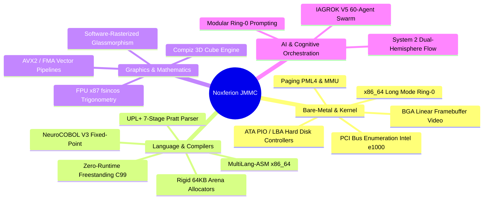

# 
👑 JOSÉ MANUEL MORENO CANO (NOXFERION)

### 
Systems Architect, Neuro-Designer & Applied AI Engineer

  <code>👑 AUTHORITY SEAL: 0x4A4D4D43 (*JMMC*) | RING-0 ENGINE SIGNATURE: 0x4359454E</code>
    

  
  
  
  
  
  

   

  **Architecting Native C/ASM Runtimes · Multi-Language Pratt Compilers · Cognitive Bare-Metal OS · Zero-Host Dependency Matrix**  
  *Creador de UPL+, MultiLang-ASM, NeuroCOBOL-V3.0, Micro-FS GXNOX y el Kernel Soberano NEURO-OS Genesis.*

---

## 📌 Executive Summary / Resumen Ejecutivo

* **EN:** **Systems Architect & Neuro-Designer** with an uncompromising focus on native hardware execution, physical memory management, and cognitive language engineering. Creator and architect of sovereign systems executing directly on bare-metal x86_64 Long Mode (Ring-0) without OS host crutches (zero Windows/Linux kernel runtime dependencies). Pioneer in the **Neuro-Architect Co-Design Paradigm**: structural engineering of complex silicon architectures orchestrated through precision low-level prompting and multi-agent synthesis.
* **ES:** **Arquitecto de Sistemas y Neuro-Diseñador** con enfoque absoluto en ejecución sobre hardware nativo, gestión física de memoria y compiladores cognitivos. Creador y arquitecto de sistemas soberanos en Long Mode x86_64 (Ring-0) sin dependencias de sistemas operativos anfitriones (cero runtime de Windows o Linux). Pionero en el **Paradigma de Co-Diseño Neuronal**: conceptualización estructural de arquitecturas de silicio orquestadas mediante prompting modular de bajo nivel y agentes paralelos.

---

## 🏛️ Proprietary Systems & Inventions / Invenciones y Núcleos Soberanos

| System / Sistema | Technical Description / Descripción Técnica | Silicon Status / Estado | IP Registration / Licencia |
| :--- | :--- | :--- | :--- |
| **NEURO-OS Genesis** | Microkernel preemptivo puro x86_64 Long Mode (Ring-0), paginación PML4 de 4 niveles, IDT/GDT nativa, drivers e1000/ATA LBA y conmutación de resolución dinámica en Linear Framebuffer (LFB). | 🟢 Operativo / Bare-Metal | Propietaria / Closed Silicon |
| **TITAN Apocalypse Engine** | Motor 3D Compiz Cube cinematográfico en CPU pura a 240 FPS sobre Framebuffer, sombreado PBR y multitarea con escritorios virtuales rotatorios. | 🟢 240 FPS Matrix | DVTRGA-30 Commercial Core |
| **UNIVERSAL-POLYGLOT-LAYER (UPL+)** | Cadena de herramientas y compilador nativo (`uplc.exe`) con analizador Pratt de 7 etapas, asignadores arena rígidos de 64KB y ABI C interoperable. | 🟢 100% Tests Passed | Sovereign Architecture |
| **MultiLang-ASM** | Ensamblador multilingüe universal que compila código máquina x86_64 usando mnemónicos en español, chino y otros idiomas nativos con pipeline FPU/AVX2. | 🟢 FPU fsincos Operativo | Open Spec / Registrada |
| **NeuroCOBOL-V3.0** | Compilador y motor transaccional de lógica de negocio cognitiva compatible con 154 idiomas y aritmética de punto fijo COMP-3 sin deriva flotante. | 🟢 154 Langs Active | Safe Creative: `2609217054592` |
| **GXNOX-v3.0 Storage Engine** | Sistema de archivos y almacenamiento en bloques con paridad dual par/impar, auto-reparación sub-20 µs y vectorización SIMD AVX2. | 🟢 Auto-Healing LBA | Safe Creative: `2610197364465` |

---

## 🚀 Live Interactive Portfolio & Documentation

* 🌐 [**`Live Interactive Web CV`**](https://cyberenigma-lgtm.github.io/CV-Noxferion/) — Simulador interactivo de consola terminal, métricas dinámicas en tiempo real y arquitectura de cristal glassmorphic.
* 📄 [**`CV_Jose_Manuel_Moreno.md`**](CV_Jose_Manuel_Moreno.md) — Curriculum Vitae universal en Markdown (Versión Raíz).
* 📄 [**`cv/CV_Jose_Manuel_Moreno_General.md`**](cv/CV_Jose_Manuel_Moreno_General.md) — CV técnico exhaustivo para roles de liderazgo e ingeniería de sistemas.
* 📄 [**`cv/CV_Jose_Manuel_Moreno_Suno_AI.md`**](cv/CV_Jose_Manuel_Moreno_Suno_AI.md) — Perfil especializado en Audio AI, síntesis generativa y modelos cognitivos.

---

## 🛠️ Technical Competencies / Competencias Técnicas

---

## 📬 Direct Contact & Verifications / Contacto y Verificación

* **Name / Nombre**: José Manuel Moreno Cano (*Noxferion*)
* **Authority Seal / Sello**: `0x4A4D4D43 (*JMMC*)`
* **Location / Ubicación**: Spain (CET / UTC+1) | Open to Global Remote / High-Impact Relocation
* **Email**: `josem.moreno.cano@gmail.com`
* **WhatsApp Direct**: [+34 630 189 616](https://wa.me/34630189616)
* **GitHub Profile**: [github.com/cyberenigma-lgtm](https://github.com/cyberenigma-lgtm)
* **LinkedIn**: [linkedin.com/in/jose-manuel-moreno-cano-8b2b47287/](https://www.linkedin.com/in/jose-manuel-moreno-cano-8b2b47287/)
* **Intellectual Property Vault**: Registered at [Safe Creative](https://www.safecreative.org) (`2609217054592`, `2610197364465`)

  <code>[ CV-NOXFERION ARCHIVE SEALED // INTEGRITY VERIFIED // 0x4A4D4D43 ]</code>

